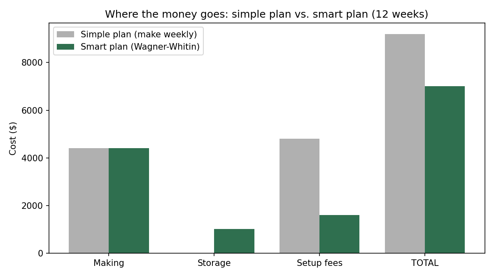
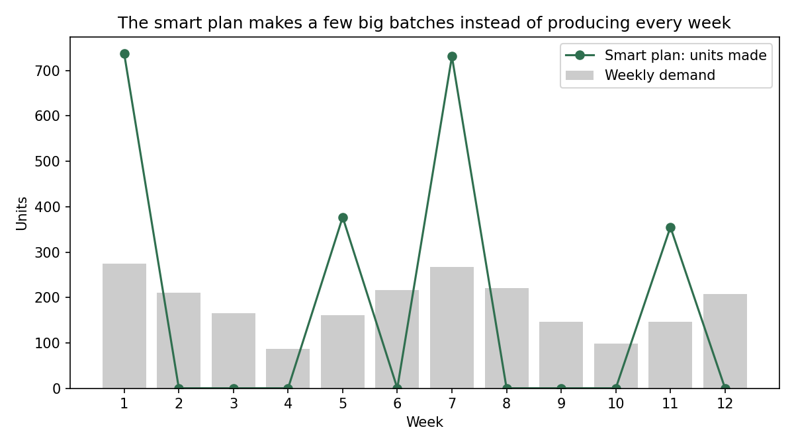

# Inventory Optimization

Single-item lot-sizing solver. Decides how much to produce each period to meet demand at minimum total cost (production + holding + setup), using the Wagner-Whitin dynamic program. A lot-for-lot heuristic is included as a baseline to measure against.

## Run

```bash
python main.py
```

No dependencies. Edit the `config` dict at the top of `main.py` to switch between a single scenario and the 999-scenario sweep.

## Results

On the default 12-week scenario, Wagner-Whitin produces in 4 periods instead of 12 for a 23.7% lower total cost. Over 999 random scenarios it averages ~22.8% savings and never loses to the baseline.




See [`media/sample_report.txt`](media/sample_report.txt) and [`media/results.xlsx`](media/results.xlsx) for the full per-period breakdown.

## Files

| File | Role |
| --- | --- |
| `main.py` | Scenario generator, runner, cost report |
| `improved_strategy.py` | Wagner-Whitin DP (`solve_lot_sizing`, `build_and_solve`) |
| `baseline_strategy.py` | Lot-for-lot baseline (`lot_for_lot`) |
| `planning_data.py` | `PlanningData` / `Plan` dataclasses |
| `media/generate_media.py` | Regenerates the charts and workbook (`pip install -r requirements.txt`) |

Algorithm reference: [MIT OCW Logistics Systems, Lecture 9](https://ocw.mit.edu/courses/esd-260j-logistics-systems-fall-2006/60025416518c3c513f34362c16d2f6ac_lect9.pdf).
